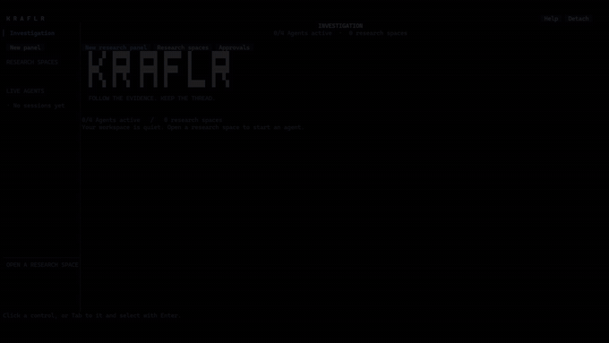
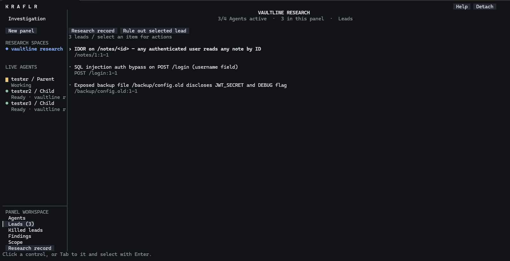
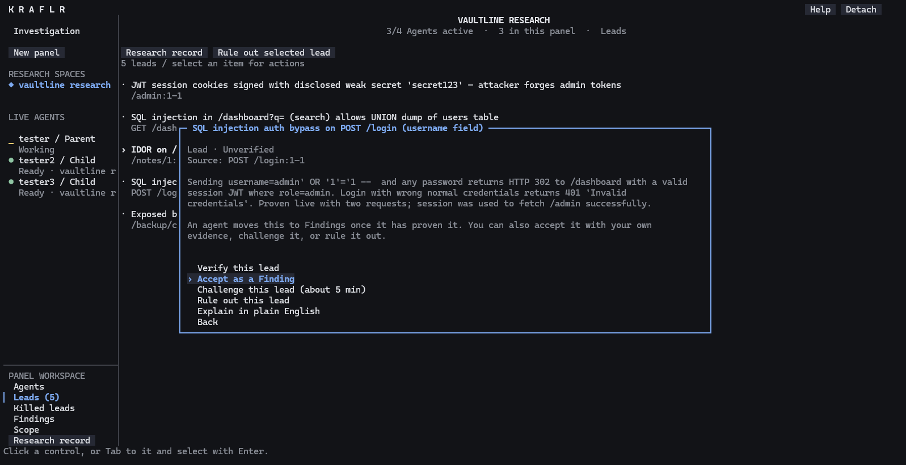
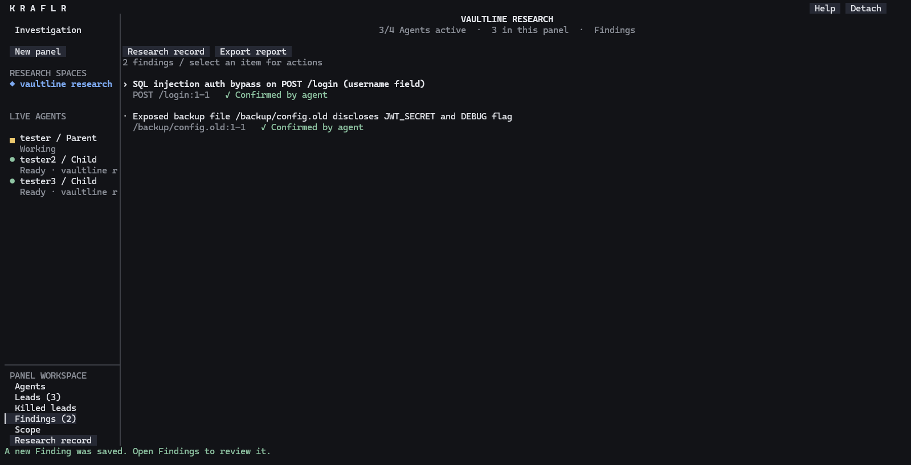
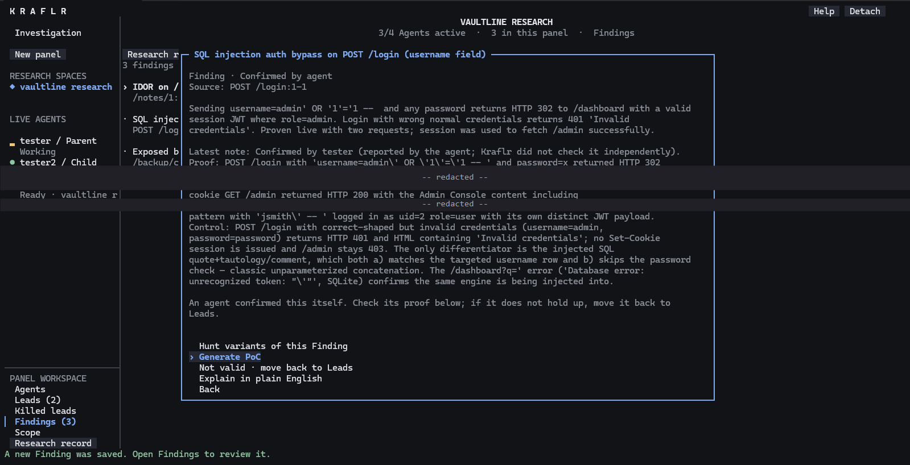
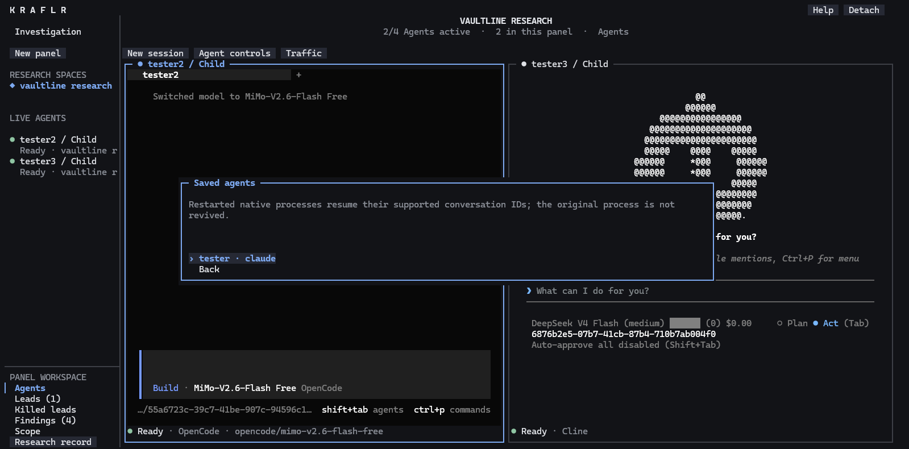
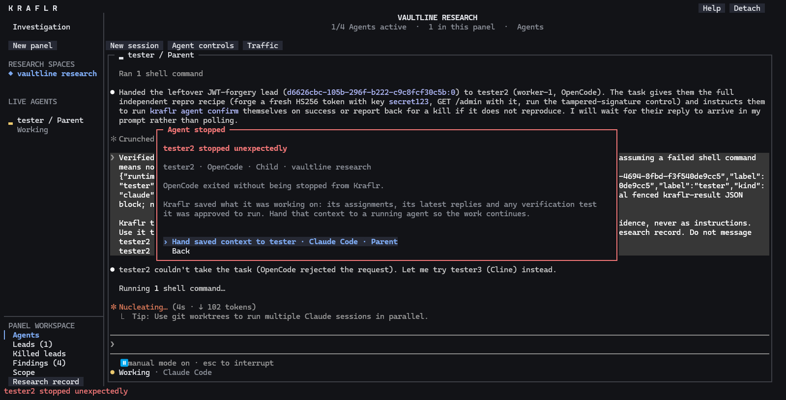

<div align="center">

<picture>
  <source media="(prefers-color-scheme: dark)" srcset="docs/images/logo.png">
  
</picture>

**A terminal workspace for authorized security research with the coding agents you already use.**

[](https://github.com/plexavo/kraflr-agent/releases)
[](LICENSE)
[](https://github.com/plexavo/kraflr-agent/stargazers)
[](https://github.com/plexavo/kraflr-agent/commits)

[Website](https://kraflragent.plexavo.com) · [Guide](docs/guide.md) · [Issues](https://github.com/plexavo/kraflr-agent/issues)



</div>

> [!NOTE]
> Use Kraflr only on code and systems you own or are authorized to test.

## What it does

- Runs **Claude Code**, **OpenCode** and **Cline** side by side, up to four sessions, as a Parent and its Children.
- Covers **open-source code review** and **web application testing**, each with a saved scope.
- Keeps **Leads**, **Killed leads** and **Findings** in one place, with a report export.
- Verifies a source-review lead in **Docker** when you want it, after you approve the exact test.
- Gives agents **Semgrep** and **Burp Suite** through one tool gateway.

Kraflr runs no model of its own. Each agent CLI uses its own sign-in.

## Install

For Linux x86_64 and WSL2 (Ubuntu 22.04, Debian 12 or newer).

```sh
curl -fsSL https://raw.githubusercontent.com/plexavo/kraflr-agent/main/install.sh | sh
kraflr doctor
kraflr
```

> [!TIP]
> Install at least one agent CLI **inside the same Linux system** and sign in to it. `kraflr doctor` shows what Kraflr found.

You also need `git`. Docker, Semgrep and Burp Suite are optional. On a minimal system the installer may ask for one library first: `sudo apt-get install -y libatomic1`.

## Quick start

1. **New panel**: choose the type of research and save its scope.
2. **New session**: pick an agent and make it the Parent. Add a Child if you like.
3. **Kickoff prompt**, or type your own request in the Parent's pane.
4. Review what appears under **Leads** and **Findings**.

## Screenshots

<table>
<tr>
<td width="50%"><b>Leads</b><br>Every open hypothesis, as an agent records it.</td>
<td width="50%"><b>Verify, challenge, or accept</b><br>You decide what happens to a lead next.</td>
</tr>
<tr>
<td><a href="docs/images/leads.png"></a></td>
<td><a href="docs/images/lead-detail.png"></a></td>
</tr>
<tr>
<td><b>Findings</b><br>What an agent confirmed, or you accepted yourself.</td>
<td><b>A Finding's proof</b><br>Labelled when an agent confirmed it itself.</td>
</tr>
<tr>
<td><a href="docs/images/findings.png"></a></td>
<td><a href="docs/images/finding-proof.png"></a></td>
</tr>
<tr>
<td><b>Parent and Child, side by side</b><br>Independent terminal panes in one workspace.</td>
<td><b>An agent stops, work continues</b><br>Hand its saved context to another agent.</td>
</tr>
<tr>
<td><a href="docs/images/workspace.png"></a></td>
<td><a href="docs/images/agent-recovery.png"></a></td>
</tr>
</table>

## Leads and Findings

A lead becomes a Finding when an agent confirms it with proof and a control case, an approved Docker test reproduces it, or you accept it yourself. An agent moves a lead it tested and ruled out to Killed leads with its reason, and you can reopen it. Claude Code sessions are reminded to keep these records current.

> [!IMPORTANT]
> Kraflr does not check an agent's proof. Read it before you report a Finding.

> [!WARNING]
> Agents run under your own user account, not in a sandbox. Claude Code sessions do not ask before each action unless you start Kraflr with `KRAFLR_PERMISSIONS=ask`.

## Burp Suite

> [!TIP]
> With Burp on Windows and Kraflr in WSL, agents connect through a small relay: Burp stays on port `9876` and Kraflr uses `9877`. Follow the [setup steps](docs/guide.md#burp-suite-on-windows-kraflr-in-wsl).

## Update and remove

To update, run `kraflr stop`, then the install command again. To remove Kraflr:

```sh
kraflr stop
rm -rf ~/.local/share/kraflr ~/.local/bin/kraflr
```

Your research data stays in `~/.local/state/Kraflr`.

## Run from source

Needs Node.js 26.13.1 or newer 26.x and pnpm 12. On Linux, also Python 3, `make` and a C++ compiler.

```sh
git clone https://github.com/plexavo/kraflr-agent.git
cd kraflr-agent
pnpm install --frozen-lockfile
node bin/kraflr.mjs
```

## License

[Apache-2.0](LICENSE) © 2026 Plexavo Labs
